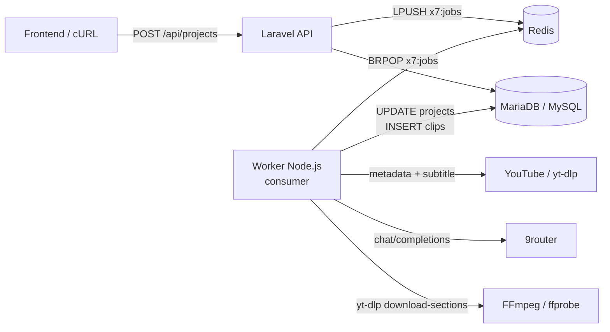

# x7clipper

Ubah podcast/video YouTube panjang jadi klip pendek siap tayang. Transkrip diekstrak, momen terbaik dipilih AI lewat **9router**, segmen video dipotong parsial, lalu difinalkan lewat web editor.


> Status: **MVP dalam pengerjaan**. Pipeline analisis sudah jalan end-to-end (Laravel → Redis → worker Node → 9router → MariaDB). Web editor dan render final belum selesai.

---

## Kenapa proyek ini

Mencari potongan 30–75 detik yang menarik dari video 60–120 menit itu manual, lambat, dan boros bandwidth kalau harus mengunduh video penuh dulu.

x7clipper menyelesaikan tiga masalah itu sekaligus:

- **AI memilih momen, bukan menebak timestamp.** LLM hanya boleh merujuk `segment_id` dari transkrip yang sudah dinormalisasi (`[S12|83] ...`). Worker yang memetakan ID ke detik presisi.
- **Video panjang dipecah cerdas.** < 20 menit dikirim utuh; ≥ 20 menit dipecah per 15 menit dengan overlap 2 menit, lalu hasilnya dideduplikasi.
- **Tidak ada unduhan video penuh.** Segmen diambil on-demand via `yt-dlp --download-sections "*start-end"`, lalu keyframe dirapikan FFmpeg supaya tidak freeze di browser.

---

## Arsitektur



| Komponen | Tanggung jawab |
|---|---|
| `backend/` | REST API, validasi URL, migrasi & model, enqueue job ke Redis |
| `worker/` | `yt-dlp`, parser transkrip, chunker, client 9router, validator, DB writer |
| `frontend/` | React + Vite + Tailwind (belum diimplementasi; masih placeholder) |
| `storage/` | `tmp/`, `transcripts/`, `raw-clips/`, `exports/` (di-gitignore) |

### Alur analisis

1. `POST /api/projects` menyimpan `projects` berstatus `queued`, lalu `LPUSH` job JSON ke list Redis `x7:jobs`.
2. Consumer `BRPOP` job `analyze_project` dan mengambil metadata + subtitle (`id`/`en`) via `yt-dlp`.
3. Transkrip dipadatkan menjadi segmen 6–10 detik ber-ID, disimpan di `transcript_segments_json`.
4. Segmen di-chunk, tiap chunk dikirim ke 9router (`temperature 0.2`, `response_format: json_object`).
5. Output AI divalidasi: ID harus ada di `segmentMap`, durasi 15–110 detik, padding `-0.35s` / `+0.50s`.
6. Klip yang tumpang tindih > 50% dideduplikasi (simpan `viral_score` tertinggi).
7. Insert `clips` + update `projects.status='ready'` dalam satu transaksi.
8. Job gagal -> retry sampai 3 attempt -> `failed` + `error_message`.

---

## Stack

| Layer | Teknologi |
|---|---|
| API | Laravel 12, PHP 8.2+ |
| Database | MariaDB 10.4+ / MySQL 8 (`utf8mb4`) |
| Queue broker | Redis (list mentah `x7:jobs`, bukan queue Laravel) |
| Media worker | Node.js 20+, `mysql2`, `ioredis`, `zod` |
| Media tools | `yt-dlp`, `ffmpeg`, `ffprobe` |
| AI gateway | 9router (OpenAI-compatible `/v1/chat/completions`) |
| Frontend | React + Vite + Tailwind (rencana) |

---

## Struktur repo

```text
x7clipper/
├── backend/                 # Laravel API
│   ├── app/Http/Controllers/Api/ProjectController.php
│   ├── app/Support/JobQueue.php
│   ├── app/Models/{Project,Clip,RenderJob}.php
│   └── database/migrations/
├── worker/                  # Node.js media & AI worker
│   ├── src/
│   │   ├── consumer.js      # BRPOP + orkestrasi pipeline
│   │   ├── youtube.js       # metadata & subtitle via yt-dlp
│   │   ├── transcript.js    # VTT/SRT -> segmen ber-ID
│   │   ├── chunker.js       # sliding window 15 menit
│   │   ├── ninerouter.js    # client LLM + parser JSON/SSE
│   │   ├── validator.js     # grounding ID, durasi, padding, dedupe
│   │   ├── clipper.js       # potong segmen + re-encode
│   │   ├── subtitleShift.js # geser subtitle ke 00:00 (SRT/ASS)
│   │   ├── db.js            # satu-satunya modul yang menyentuh MySQL
│   │   └── env.js
│   ├── scripts/{healthcheck,test-analyze}.js
│   └── test/                # node:test (40 test)
├── frontend/                # placeholder
├── storage/                 # runtime files (gitignored)
├── docs/progress.md
├── PRD.md                   # spesifikasi produk
├── AGENTS.md                # aturan arsitektur & handoff agent
└── .env.example             # env root, dipakai worker
```

---

## Prasyarat

- PHP **8.2+** + Composer
- Node.js **20+** (dikembangkan di Node 24)
- MariaDB **10.4+** / MySQL **8**
- Redis **7** di `127.0.0.1:6379`
- `yt-dlp`, `ffmpeg`, `ffprobe` ada di `PATH`
- Akun/endpoint **9router** dengan API key + model ID

Verifikasi binary:

```bash
yt-dlp --version
ffmpeg -version
ffprobe -version
```

---

## Setup

### 1. Clone & dependency

```bash
git clone https://github.com/agilfebripradana123/x7clipper.git
cd x7clipper

composer --working-dir=backend install
npm --prefix worker install
```

### 2. Env backend (Laravel)

```bash
cp backend/.env.example backend/.env
php backend/artisan key:generate
```

Sesuaikan koneksi DB di `backend/.env`:

```dotenv
DB_CONNECTION=mysql
DB_HOST=127.0.0.1
DB_PORT=3306
DB_DATABASE=x7clip
DB_USERNAME=root
DB_PASSWORD=

REDIS_CLIENT=predis
REDIS_HOST=127.0.0.1
REDIS_PORT=6379
REDIS_PREFIX=
QUEUE_CONNECTION=redis
```

> `predis/predis` dipakai karena ekstensi `phpredis` tidak selalu tersedia. `REDIS_PREFIX` sengaja kosong agar key `x7:jobs` dibaca persis sama oleh Laravel dan Node.

### 3. Env worker (root `.env`)

```bash
cp .env.example .env
```

Isi minimal:

```dotenv
NINEROUTER_BASE_URL=http://127.0.0.1:20128/v1
NINEROUTER_API_KEY=sk-...
NINEROUTER_MODEL=your-model-id

DB_HOST=127.0.0.1
DB_PORT=3306
DB_DATABASE=x7clip
DB_USERNAME=root
DB_PASSWORD=
```

### 4. Migrasi

```bash
php backend/artisan migrate
```

### 5. Healthcheck

```bash
cd worker
npm run healthcheck

# ikut menembak 9router (butuh kredit/kuota)
# PowerShell
$env:NINEROUTER_HEALTHCHECK='true'; npm run healthcheck
```

Output yang diharapkan: `PASS` untuk `yt-dlp`, `ffmpeg`, `ffprobe`, Redis, dan 9router.

---

## Menjalankan

Butuh **dua terminal terpisah**. Jangan jalankan daemon dari proses lain/agent.

```bash
# Terminal 1 — API
php backend/artisan serve --host=127.0.0.1 --port=8000
```

```bash
# Terminal 2 — worker
cd worker
npm run consumer
# [11:15:14] consumer siap, BRPOP x7:jobs
```

Lalu buat project:

```bash
curl -X POST http://127.0.0.1:8000/api/projects \
  -H "Content-Type: application/json" \
  -d '{"youtube_url":"https://www.youtube.com/watch?v=hXOo7FdQVrk"}'
```

```json
{
  "data": {
    "id": 8,
    "youtube_url": "https://www.youtube.com/watch?v=hXOo7FdQVrk",
    "status": "queued",
    "created_at": "2026-11-20T11:19:20.000000Z"
  }
}
```

Pantau hasil:

```bash
curl http://127.0.0.1:8000/api/projects/8
```

Status bergerak `queued → extracting → analyzing → ready` (atau `failed`).

---

## API

### `POST /api/projects`

Membuat project dan mengantrekan job analisis.

Body:

| Field | Tipe | Wajib | Catatan |
|---|---|---|---|
| `youtube_url` | string | ya | `youtube.com/watch?v=`, `youtu.be/`, `/live/`, `/shorts/`; maks 512 karakter |

Respons `201`:

```json
{
  "data": {
    "id": 8,
    "youtube_url": "https://youtu.be/hXOo7FdQVrk",
    "status": "queued",
    "created_at": "2026-11-20T11:19:20.000000Z"
  }
}
```

Error: `422` bila URL tidak valid, `503` bila gagal enqueue Redis (project ditandai `failed`).

### `GET /api/projects/{id}`

Mengembalikan status pipeline + daftar klip urut `viral_score` menurun.

```json
{
  "data": {
    "id": 8,
    "youtube_url": "https://youtu.be/hXOo7FdQVrk",
    "video_title": "Kenapa Kamu Sulit Akur dengan Orang Tua",
    "duration_sec": 1104,
    "status": "ready",
    "error_message": null,
    "created_at": "2026-11-20T11:19:20.000000Z",
    "clips": [
      {
        "id": 5,
        "title": "Takut jadi bapak buruk kayak bapak sendiri",
        "start_sec": 749.479,
        "end_sec": 823.29,
        "viral_score": 92,
        "hook_type": "emotional",
        "ai_reason": "...",
        "suggested_caption": "...",
        "raw_clip_path": null
      }
    ]
  }
}
```

Endpoint yang belum ada: `POST /api/clips/{id}/prepare`, `PATCH /api/clips/{id}/config`, `POST /api/clips/{id}/render`, `GET /api/render-jobs/{id}`, `GET /api/clips/{id}/video`.

---

## Kontrak job queue

Backend dan worker tidak berbagi kode, hanya list Redis `x7:jobs` berisi JSON:

```json
{ "type": "analyze_project", "project_id": 8, "attempt": 1 }
```

- `attempt` naik maksimal 3. Gagal di attempt 3 -> `projects.status='failed'` + `error_message`.
- Tipe job lain diabaikan oleh consumer saat ini.
- `clips: []` hanya sah kalau AI benar-benar mengembalikan `"clips": []`. Kalau **semua** chunk gagal dianalisis, job dianggap gagal, bukan `ready` dengan 0 klip.

---

## CLI worker

```bash
cd worker

# analisis 1 URL tanpa lewat Redis/DB (debug pipeline)
npm run analyze -- "https://youtu.be/hXOo7FdQVrk"

# cek binary + Redis + 9router
npm run healthcheck

# test
npm test
```

`npm run analyze` mencetak ringkasan chunk, klip yang lolos validasi, dan menyimpan hasil mentah ke `storage/tmp/analysis-<id>.json`.

---

## Skema database

| Tabel | Kolom penting |
|---|---|
| `projects` | `youtube_url`, `video_title`, `duration_sec`, `transcript_segments_json`, `status` (`queued/extracting/analyzing/ready/failed`), `error_message` |
| `clips` | `project_id`, `title`, `start_sec`, `end_sec`, `viral_score`, `hook_type`, `ai_reason`, `suggested_caption`, `raw_clip_path`, `subtitle_json`, `edit_config_json` |
| `render_jobs` | `clip_id`, `status` (`queued/rendering/done/failed`), `progress_percent`, `output_url`, `error_message` |

Catatan:

- `clips.start_sec/end_sec` sudah termasuk padding pengaman.
- `subtitle_json` dan `edit_config_json` disimpan sebagai JSON string di kolom `longText`.
- Koordinat crop disimpan sebagai rasio `0.0–1.0`, bukan piksel, supaya preview browser dan render FFmpeg identik.
- Semua kolom teks `utf8mb4`; pool `mysql2` menyetel `charset: 'UTF8MB4_UNICODE_CI'` eksplisit.

---

## Testing

```bash
# worker (node:test)
cd worker
npm test
# tests 40 / pass 40

# backend (phpunit, DB test terpisah)
cd backend
php artisan test
```

`backend/phpunit.xml` memakai database terpisah (default `x7clip_test`) supaya `RefreshDatabase` tidak menghapus data development.

---

## Troubleshooting

| Gejala | Penyebab | Solusi |
|---|---|---|
| Project `ready` tapi `clips: []` | Semua chunk gagal diparse | Cek log consumer untuk `chunk N gagal, dilewati`; pastikan 9router membalas JSON valid. Kode sekarang menggagalkan job, bukan silent `ready`. |
| 9router balas SSE walau `stream: false` | Perilaku combo/model tertentu | Worker membaca body sebagai teks, `JSON.parse`, fallback parser SSE — jangan andalkan `content-type`. |
| `Unknown charset 'utf8mb4'` | `mysql2` butuh nama collation | Pakai `charset: 'UTF8MB4_UNICODE_CI'`. |
| Emoji/caption error saat insert | Koneksi/kolom bukan utf8mb4 | Pastikan DB & tabel `utf8mb4`, charset pool eksplisit. |
| Job tidak diproses | Consumer tidak jalan / key Redis beda | Jalankan `npm run consumer`; cek `REDIS_PREFIX=` kosong dan list `x7:jobs`. |
| `yt-dlp` gagal ambil subtitle | Video tanpa caption `id`/`en` | Pilih video lain atau tambahkan bahasa di `worker/src/youtube.js`. |

---

## Roadmap

- [x] **Fase 0** — struktur repo, `.env.example`, healthcheck
- [x] **Fase 1** — metadata/subtitle, parser segmen, chunker, client 9router, validator, dedupe
- [x] **Fase 2** — smart clipping parsial + re-encode, subtitle shifting ke `00:00` (JSON/SRT/ASS)
- [ ] **Fase 3** — API & queue
  - [x] migrasi & model
  - [x] `POST /api/projects`
  - [x] `GET /api/projects/{id}`
  - [x] consumer Redis + DB writer transaksional
  - [ ] `POST /api/clips/{id}/prepare` (idempoten, `prepare_status`)
  - [ ] `GET /api/clips/{id}/video` (Range/206)
  - [ ] `PATCH /api/clips/{id}/config`
  - [ ] `POST /api/clips/{id}/render` + `GET /api/render-jobs/{id}`
- [ ] **Fase 4** — frontend React: input URL, tracker status, daftar klip, web editor (trim, crop `9:16`, subtitle overlay), export
- [ ] **Fase 5** — render FFmpeg final (trim + crop + burn-in ASS), batas konkurensi, cleanup 24 jam, upload MP4 fallback

Detail spesifikasi: [`PRD.md`](PRD.md). Aturan arsitektur & progres agent: [`AGENTS.md`](AGENTS.md), [`docs/progress.md`](docs/progress.md).

---

## Catatan

- Proyek ini private/WIP belum punya lisensi. Jangan distribusikan tanpa izin.
- `storage/` dan `.env` tidak masuk repo; isi sendiri sesuai contoh.
- Job analisis berjalan asinkron. Jangan menjalankan `php artisan serve` atau consumer dari dalam skrip otomatis yang memblokir terminal.
